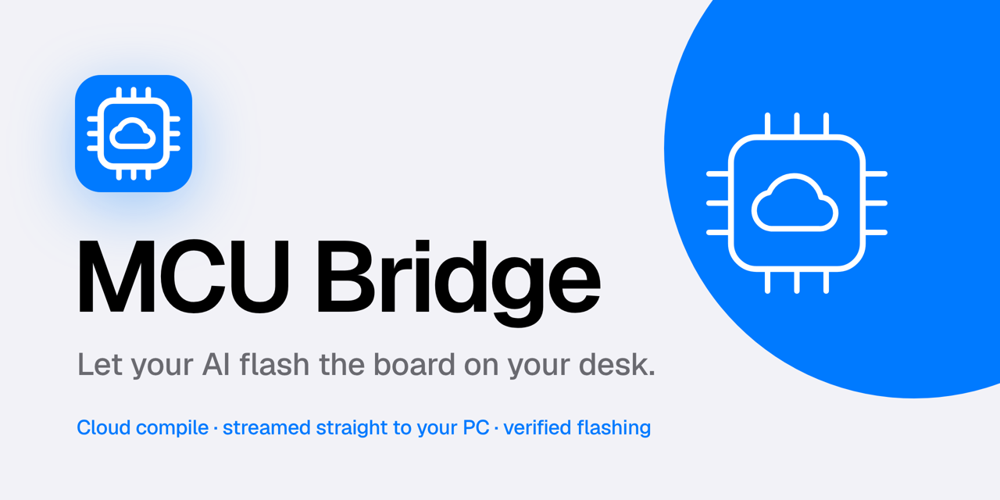
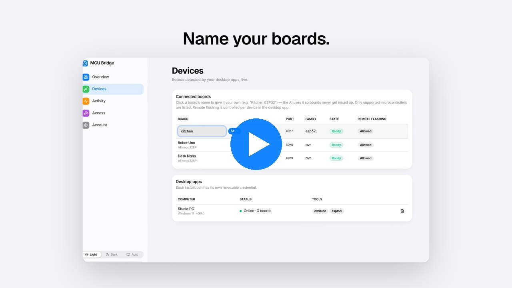
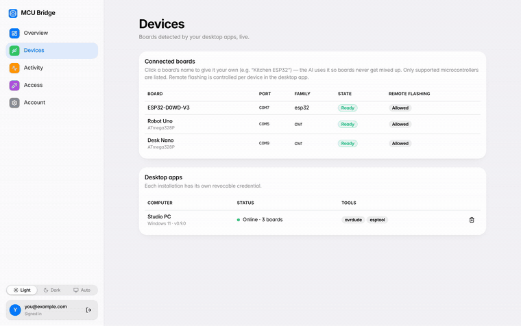
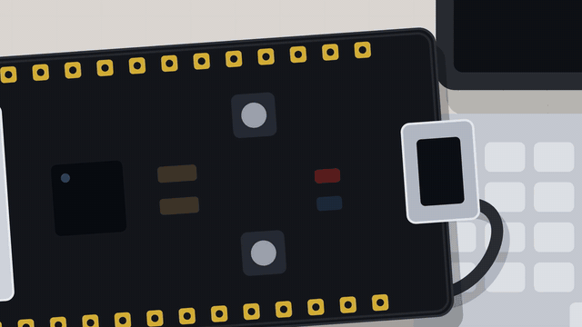
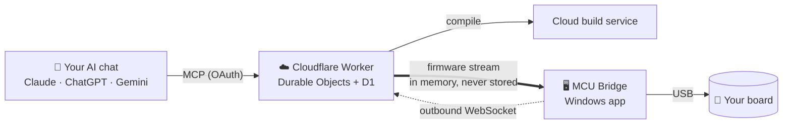
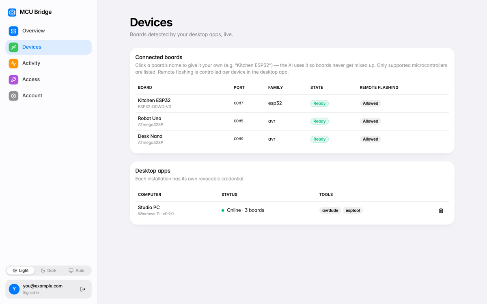
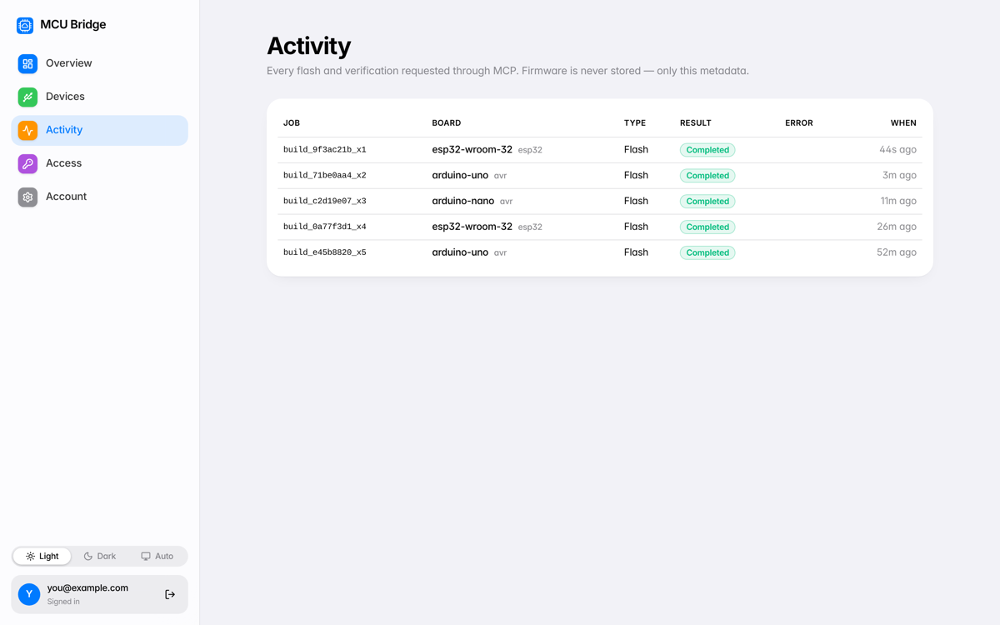

<div align="center">



<br>

**Tell your AI to flash your board. It compiles in the cloud, streams the firmware to your PC, and flashes the real chip — then proves it worked.**

[](#2-install-the-windows-app)
[](#how-it-works)
[](#3-connect-your-ai)
[](#development)
[](LICENSE)

[**Watch the film**](#see-it) · [**Get started**](#get-started) · [**What your AI can do**](#what-your-ai-can-do) · [**Supported boards**](#supported-boards) · [**Docs**](#documentation)

</div>

---

## What is this?

AI assistants can write firmware, but they can't touch the board on your desk. You end up copying code, finding the COM port, picking
the right flasher and hoping it works.

**MCU Bridge closes that gap.** You install a small app on your Windows PC and add one connector to your AI. From then on you can say:

> *"Blink the LED on my ESP32."*  ·  *"Flash this sketch to the Uno."*  ·  *"Put the last build back on the Nano."*

…and it happens — in **any AI chat**, with **no code sandbox and no local toolchain** needed.

| | |
|---|---|
| ☁️ **Compiles in the cloud** | Arduino sketches, **third-party libraries** included. Your PC never compiles. |
| 🔌 **Streams straight to your PC** | Firmware travels through an in-memory relay. It is **never stored** in the cloud. |
| ✅ **Verified, not assumed** | A flash only counts as done when the desktop app confirms it (read-back + SHA-256). |
| 🧰 **The right tool per board** | avrdude for Arduino/AVR, esptool for ESP32/ESP8266 — chosen automatically. |
| 🆔 **Auto-detects your board** | Tells Uno, Nano, old-bootloader Nano and Mega apart by trying each speed. |
| 🏷️ **Name your boards** | "Kitchen ESP32", "Robot Uno" — the AI uses your names so boards never get mixed up. |
| 🧾 **Build history & re-flash** | Every build is recorded (hashes, never firmware). Re-flash any earlier build in one sentence. |
| 💾 **Full ESP32 images** | Bootloader + partition table + app, so even a **blank chip boots**. |

## See it

<div align="center">

[](docs/assets/launch-film.mp4)

*Click to watch the 1-minute launch film.*

</div>

<table>
<tr>
<td width="50%"><br><sub><b>The dashboard, for real:</b> name a board, watch it flash, see it logged.</sub></td>
<td width="50%"><br><sub><b>The payoff:</b> the LED on the board blinks. (Illustration from the launch film.)</sub></td>
</tr>
</table>

## How it works



1. You ask your AI. It calls the MCU Bridge tools over **MCP**.
2. The Worker compiles your sketch in the cloud (or accepts firmware your AI built).
3. The firmware streams to your PC **through memory only**. The desktop app checks size and SHA-256, flashes, resets, captures the boot log and reports back.
4. The AI tells you what happened — and can say "flashed" only if the desktop app confirmed it.

Your PC makes only **outbound** connections: no open ports, no port forwarding, no localhost server.

## Get started

You need a free [Cloudflare](https://dash.cloudflare.com/sign-up) account (the cloud part), a Windows 10/11 PC with your board plugged in (the desktop part),
and any AI chat that supports MCP connectors. Setup takes about 10 minutes.

> **Just want to look around?** A live instance runs at **<https://mcub.manthank.com>** (invite-only). To use MCU Bridge yourself, deploy your own below — it is free on Cloudflare's plan.

### 1. Deploy the cloud (once)

```bash
git clone https://github.com/acegikmo135/Flashlink.git
cd Flashlink
node scripts/setup.mjs            # Windows PowerShell users can run .\scripts\setup.ps1
```

The script installs dependencies, logs you in to Cloudflare in your browser, creates the database, deploys the Worker and prints:

* your **Worker URL** (e.g. `https://mcu-bridge.<you>.workers.dev`), and
* an **invite code** (needed once, to create your account).

<details>
<summary><b>Use your own domain</b> (e.g. <code>mcub.example.com</code>)</summary>

If the domain's DNS is on your Cloudflare account:

```bash
node scripts/setup.mjs --domain mcub.example.com
```

Cloudflare creates the DNS record and the certificate for you. Re-running the script keeps the domain. Details: [docs/setup.md](docs/setup.md).
</details>

Open `https://<your-worker>/signup`, create your account with the invite code, and you land on the dashboard.

> **Hand out access to others:** set `ADMIN_EMAIL` to your account and visitors can request an invite at `/request-invite`; you approve from **Dashboard → Admin** and the code is emailed to them — see [docs/setup.md](docs/setup.md#invite-requests-and-the-admin-dashboard).

### 2. Install the Windows app

[**⬇ Download MCUBridge-Setup.exe**](https://github.com/acegikmo135/Flashlink/releases/download/desktop-latest/MCUBridge-Setup.exe) (about 28 MB, per-user install, no admin rights).

Run it, open the pairing link it shows (or scan the QR code), sign in and press **Approve**. The app lives in your tray and reconnects on its own.
Missing a flasher? The **Tools** page has a **Download** button next to each one (avrdude, OpenOCD, …). ESP32 works out of the box.

> Unsigned build: Windows SmartScreen may say "More info → Run anyway".

### 3. Connect your AI

Add your Worker as a **custom connector** — no token to copy, you just sign in once:

| Where | What to do |
|---|---|
| **claude.ai** | Settings → Connectors → **Add custom connector** → URL `https://<your-worker>/mcp` → **Connect** |
| **ChatGPT** | Settings → Connectors → add a custom connector with the same URL |
| **Gemini** | Add an MCP connector with the same URL (registration is automatic) |
| **Claude Code** | `claude mcp add --transport http mcu-bridge https://<your-worker>/mcp --header "Authorization: Bearer <token>"` |

*Claude Code uses a token: Dashboard → **Access** → **Create token**. Treat it like an SSH key.*

### 4. Try it

Plug in a board and ask:

> **"What boards do you see?"**
> **"Blink the LED on my ESP32."**
> **"Name this one Desk ESP32."**

For a better experience, give your AI the bundled skill: [`skills/mcu-bridge/SKILL.md`](skills/mcu-bridge/SKILL.md) (it knows which tool flashes which board and how to report results honestly).

## What your AI can do

20 tools with strict schemas and structured output.

| | Tools |
|---|---|
| **Look around** | `list_devices` · `get_device_info` · `get_device_status` · `identify_mcu` · `detect_new_devices` · `rename_device` · `get_supported_boards` |
| **Build & flash** | `build_and_flash` · `compile_firmware` · `flash_firmware` · `verify_flash` · `reset_device` |
| **Follow the job** | `get_flash_job` · `cancel_flash_job` · `get_flash_history` |
| **Builds** | `list_builds` · `flash_build` · `delete_build` |
| **Read the board** | `read_serial` · `capture_boot_log` |

Every failure comes with a specific error code (no agent connected, no device, several devices, wrong firmware target, device unplugged, flashing in progress, verification failed…).
Success means `status: "completed"` **and** `flash_confirmed: true`, set only by the desktop agent.

<details>
<summary><b>Third-party libraries & ESP32 images</b></summary>

* `libraries: ["Adafruit NeoPixel", "DHT sensor library@1.4.6"]` installs Arduino Library Manager libraries before compiling (max 10; pin a version for reproducible rebuilds).
* ESP32 builds are flashed as a **complete image** — bootloader `0x1000`, partition table `0x8000`, `boot_app0` `0xe000`, app `0x10000` — so a blank chip boots. Pass `full_image: false` to update only the app.
* `flash_build` re-flashes an earlier build by rebuilding it from the recorded source and checking its SHA-256; if the output changed it refuses unless you allow it.
</details>

## Supported boards

| Family | Boards | Flasher | Status |
|---|---|---|---|
| **ESP32** | `esp32-wroom-32` and friends | esptool (built in) | ✅ **Flashed and verified on real hardware** |
| ESP32-S2/S3/C3, ESP8266 | NodeMCU, D1 mini, … | esptool | Implemented, not yet run on hardware |
| **Arduino AVR** | Uno, Nano, Nano (old bootloader), Mega 2560 | avrdude | Implemented and hardened after a real-world failure; **not yet confirmed on hardware** |
| STM32 | Blue/Black Pill, Nucleo | CubeProgrammer / OpenOCD | Implemented, command lines unit-tested only (needs an ST-Link) |
| CH32V003 | `ch32v003f4p6` | wlink | Implemented, command lines unit-tested only (needs a WCH-LinkE) |

Details and limits: [docs/supported-boards.md](docs/supported-boards.md). Cloud compile covers Arduino Uno/Nano/Mega and ESP32.

## The dashboard

<table>
<tr>
<td></td>
<td></td>
</tr>
<tr>
<td colspan="2" align="center"><sub>Boards, tokens, connected apps and every flash — metadata only. Light, dark and auto themes. (Screenshots use fictional data.)</sub></td>
</tr>
</table>

## Security & privacy

* **Firmware is never stored** in the cloud — it exists only in a small in-memory window while it streams, and is deleted from your PC after the job. The database holds metadata only (hashes, sizes, statuses).
* Your AI can ask the PC to do **only** a short list of things: identify, flash, verify, reset, read serial. There is **no** shell, file or process access.
* Sign-in is invite-gated; the desktop app pairs with a short-lived code, and its credential is revocable and stored with Windows DPAPI.
* MCP uses **OAuth 2.1 with PKCE** (or revocable tokens). Every job is bound to a signed, expiring token; size and SHA-256 are enforced in the cloud *and* again on your PC.
* Cloud compile sends your **sketch source** to a public Arduino build service (Wokwi's). Don't compile secrets. Each build's source text is kept in *your* build history so it can be re-flashed; delete it any time with `delete_build`.

Full model: [docs/security.md](docs/security.md).

## FAQ

<details><summary><b>Does it work on macOS or Linux?</b></summary>
The cloud and the web dashboard work anywhere. The desktop app is Windows-only today (it uses Windows serial/USB APIs and DPAPI).
</details>

<details><summary><b>What does it cost?</b></summary>
It runs on Cloudflare's free plan (Workers, Durable Objects, D1). Cloud compile uses a public build service.
</details>

<details><summary><b>Can my AI do something dangerous to my PC?</b></summary>
No. The only things it can request are the flashing-related actions above, and the desktop app decides per device whether remote flashing is allowed.
</details>

<details><summary><b>Is it production-ready?</b></summary>
It's an early release. The cloud, protocol and ESP32 path are tested end to end (including on real hardware); other families are implemented but need more real-world testing — see the status column above. Reports welcome.
</details>

## Documentation

| | |
|---|---|
| [docs/setup.md](docs/setup.md) | Full setup, desktop app, connectors, token use |
| [docs/architecture.md](docs/architecture.md) | How the Worker, relay, desktop agent and protocol fit together |
| [docs/security.md](docs/security.md) | Threat model and controls |
| [docs/supported-boards.md](docs/supported-boards.md) | Boards, flashers, manifest rules, limits |
| [skills/mcu-bridge/SKILL.md](skills/mcu-bridge/SKILL.md) | A skill/prompt that teaches an AI to use the tools well |

## Development

```text
cloud/      Cloudflare Worker (TypeScript): MCP server, OAuth, relay, jobs, compile
web/        React + Tailwind + shadcn dashboard (served by the Worker)
desktop/    Windows app (Python + PySide6): agent, flashers, tool installer
shared/     Board registry and test vectors used by both sides
tests/      End-to-end tests: local Worker + real agent + simulated boards
scripts/    setup / deploy / installer publishing
docs/       Documentation and README assets
```

```bash
cd cloud && npm i && npx vitest run && npx wrangler dev      # Worker + unit tests
cd desktop && pip install -r requirements.txt && pytest tests # desktop unit tests
pytest tests                                                  # end-to-end (simulated boards)
node --test scripts/setup.test.mjs                            # setup helpers
```

The end-to-end suite pairs a real agent through the real web flow and drives the real MCP endpoint (streamed uploads, tampering, cancel, reconnect, revoke…).
Its "boards" are simulated, so **those tests prove the protocol and job logic, not physical flashing** — the ESP32 hardware run was done by hand.

The [`launch-film/`](launch-film), [`hf-film/`](hf-film), [`launch-video/`](launch-video), [`launch-video2/`](launch-video2), [`short-bang/`](short-bang) and [`short-brag/`](short-brag) folders hold the sources of the launch films (Remotion, HyperFrames and GSAP).

## License

[MIT](LICENSE). The Windows installer bundles esptool (GPL-2.0) — see its project for terms.
